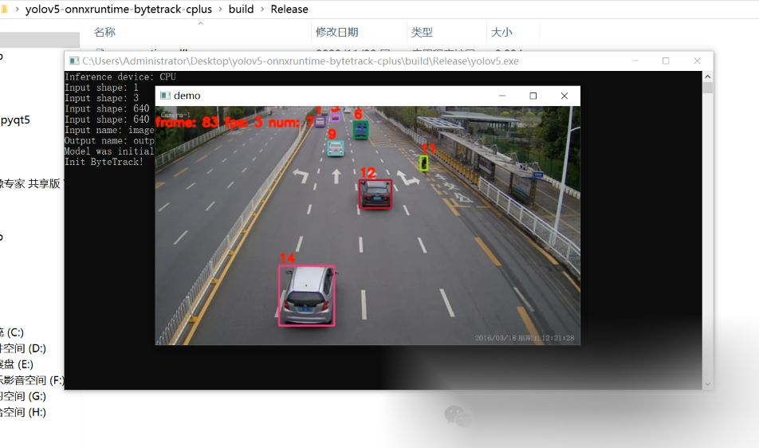

# [C++] Utilize the ONNX model of YOLOv5 combined with OpenCV and bytetrack for object tracking

[Algorithm Introduction]

The implementation of YOLOv5, ONNXRuntime, and ByteTrack for target tracking based on C++ is an efficient solution for target tracking. YOLOv5 is a superior version of the YOLO series algorithm, known for its outstanding object detection performance and real-time capabilities. ONNXRuntime is a high-performance inference engine developed by Microsoft, supporting models generated in ONNX format from various frameworks, enabling efficient model inference. ByteTrack is a target tracking method based on trajectory matching, utilizing motion information and appearance features of targets for tracking, demonstrating strong robustness and adaptability.

In the C++ environment, firstly, target detection is conducted through YOLOv5 to generate initial positions and trajectories of the targets. Then, ByteTrack utilizes this information for precise tracking of the targets. ONNXRuntime acts as the inference engine, responsible for loading and running the ONNX model of YOLOv5 to achieve efficient target detection.

This combination mode not only leverages the high detection accuracy of YOLOv5 but also utilizes the high tracking precision of ByteTrack, significantly enhancing the overall target tracking effect. Additionally, the efficient performance of C++ makes this solution outstanding in terms of real-time performance.

Overall, the implementation of YOLOv5, ONNXRuntime and ByteTrack target tracking based on C++ is an efficient, accurate and real-time target tracking solution, suitable for various complex scenarios.

[Effect Display]



[Implementation of Partial Code]

-
-
-
-
-
-
-
-
-
-
-
-
-
-
-
-
-
-
-
-
-
-
-
-
-
-
-
-
-
-
-
-
-
-
-
-
-
-
-
-
-
-
-
-
-
-
-
-
-
-
-
-
-
-
-
-
-
-
-
-
-
-
-
-
-
-
-
-
-
-
-
-
-
-
-
-
-
-
-
-
-
-
-
-
-
-
-

```
#include <iostream>#include <opencv2/opencv.hpp> #include "cmdline.h"#include "utils.h"#include "detector.h"  int main(int argc, char* argv[]){    const float confThreshold = 0.3f;    const float iouThreshold = 0.4f;        bool isGPU =false;    const std::string classNamesPath = "C:\\Users\\Administrator\\Desktop\\yolov5-onnxruntime-bytetrack-cplus\\weights\\coco.names";    const std::vector<std::string> classNames = utils_yolo::loadNames(classNamesPath);    const std::string modelPath = "C:\\Users\\Administrator\\Desktop\\yolov5-onnxruntime-bytetrack-cplus\\weights\\yolov5s.onnx";     if (classNames.empty())    {        std::cerr << "Error: Empty class names file." << std::endl;        return -1;    }     YOLODetector detector {nullptr};    detector = YOLODetector(modelPath, isGPU, cv::Size(640, 640));        std::cout << "Model was initialized." << std::endl;    std::vector<Object> result;  cv::VideoCapture cap("D:\\car.mp4");  int img_w = cap.get(CAP_PROP_FRAME_WIDTH);  int img_h = cap.get(CAP_PROP_FRAME_HEIGHT);  int fps = cap.get(CAP_PROP_FPS);  long nFrame = static_cast<long>(cap.get(CAP_PROP_FRAME_COUNT));  if (!cap.isOpened())  {    std::cout << "open capture failured!" << std::endl;    return -1;  }  Mat frame;  BYTETracker tracker(fps, 30);  int num_frames = 0;  int keyvalue = 0;    int total_ms = 1;  while (true)  {    cap.read(frame);    if (frame.empty())    {      std::cout << "read to end" << std::endl;      break;    }    num_frames++;    auto start = chrono::system_clock::now();    result.clear();    result = detector.detect(frame, confThreshold, iouThreshold);       vector<STrack> output_stracks = tracker.update(result);    auto end = chrono::system_clock::now();    total_ms = total_ms + chrono::duration_cast<chrono::microseconds>(end - start).count();    for (int i = 0; i < output_stracks.size(); i++)    {      vector<float> tlwh = output_stracks[i].tlwh;      bool vertical = tlwh[2] / tlwh[3] > 1.6;      if (tlwh[2] * tlwh[3] > 20 && !vertical)      {        Scalar s = tracker.get_color(output_stracks[i].track_id);        putText(frame, format("%d", output_stracks[i].track_id), Point(tlwh[0], tlwh[1] - 5),            0, 0.6, Scalar(0, 0, 255), 2, LINE_AA);        rectangle(frame, Rect(tlwh[0], tlwh[1], tlwh[2], tlwh[3]), s, 2);      }    }    putText(frame, format("frame: %d fps: %d num: %d", num_frames, num_frames * 1000000 / total_ms, (int)output_stracks.size()),        Point(0, 30), 0, 0.6, Scalar(0, 0, 255), 2, LINE_AA);     imshow("demo", frame);    keyvalue = waitKey(1);    if (keyvalue == 113 || keyvalue == 81)    {      break;    }   }  cap.release();      return 0;}
```

[Video demonstration]

Based on C++ using YOLOv5's ONNX model combined with OpenCV and bytetrack for object tracking - Bilibili [Test Environment] OpenCV==4.8.0 ONNXRuntime==1.16.3 VS2019 CMake==3.24.3 Code address: gitee.com/FIRC/firc-projects, Video playback volume 1, comment volume 0, like count 0, coin amount 0, collection number 0, forward number 0, video author Future Autonomous Research Center, Author's introduction to Future Autonomous Research Center.Related Video: C++ uses YOLOv11 ONNX model combined with OpenCV and bytetrack for object tracking. Based on the OpenCV C++ version YOLOv8-ONNX and bytetrack tracking algorithm, implement target tracking using Python to deploy the YOLOv10 ONNX model. C# uses ONNXRuntime to deploy the YOLOv11-ONNX instance segmentation model. Use C# to call the Libotrch-YOLO5 model to achieve the fastest winform target detection across the network. Use C++ to deploy YOLOv8's ONNX and bytetrack for object tracking.Demo of the algorithm results based on C# for WinForm Yolov8-ONNX + ByteTrack target tracking. The implementation in C++ using pure OpenCV to deploy the Yolov11-Seg instance segmentation ONNX model, and the implementation of target tracking results using Yolov11+DeepSort+PyQt5 is demonstrated. The deployment of the Yolov5 target detection model ONNXhttps://www.bilibili.com/video/BV1LnD3YdEMj/

[Test Environment]
opencv==4.8.0

onnxruntime==1.16.3

vs2019

cmake==3.24.3 

[Code Address]


## Payment

Here is a pay link on Stripe ( https://buy.stripe.com/3cs8yP7sY87d0vu9AB ). Please contact me lonlonago@foxmail.com after funding $89, and I will send you a complete data files , thank you!


